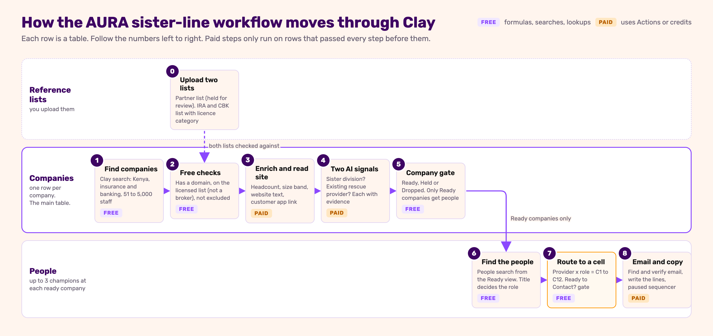

# Clay Build Guide: Multi-Entity Insurer & Bancassurance Sister-Line Expansion (AURA Kenya)

A step-by-step guide to building `output/campaigns/sister-entity-insurer-expansion/workflow-spec.md` (the W1 spec, amended 2026-11-20 for Clay) in Clay. Written for someone who has never built anything in Clay. Follow the parts in order. Each step tells you **why** it exists, **what to click**, **what to type**, **how to check it worked** and **what it costs**.

> **Don't skip the checks.** The most common Clay mistake is running a column on 500 rows before checking it worked on 1. Every step below ends with a check. If the check fails, fix it before moving on. Three rules hold the whole way: **auto-run off** on every table, **free before paid**, and **prove every column on one row** (AI columns on two or three rows you can judge) before running the rest.

---

## Contents

- [What you are building](#what-you-are-building)
- [Clay words you need](#clay-words-you-need)
- [Before you start](#before-you-start)
- [Part 0. Set up the workbook](#part-0-set-up-the-workbook)
- [Part 1. Reference tables (partner list and IRA/CBK list)](#part-1-reference-tables)
- [Part 2. Find the companies (free search)](#part-2-find-the-companies)
- [Part 3. Free checks on each company](#part-3-free-checks-on-each-company)
- [Part 4. Enrich each company and check its size](#part-4-enrich-each-company-and-check-its-size)
- [Part 5. Read each company's website](#part-5-read-each-companys-website)
- [Part 6. Signal 1: does it run a sister division? (AI)](#part-6-signal-1-does-it-run-a-sister-division)
- [Part 7. Signal 2: who provides its rescue today? (AI)](#part-7-signal-2-who-provides-its-rescue-today)
- [Part 8. The company gate](#part-8-the-company-gate)
- [Part 9. People table (find the champions)](#part-9-people-table)
- [Part 10. Route each person to a cell](#part-10-route-each-person-to-a-cell)
- [Part 11. Find and verify the work email](#part-11-find-and-verify-the-work-email)
- [Part 12. Write the email lines](#part-12-write-the-email-lines)
- [Part 13. Views for the operator](#part-13-views-for-the-operator)
- [Part 14. Connect the sequencer (build it, don't run it)](#part-14-connect-the-sequencer)
- [What it costs](#what-it-costs)
- [Final checklist](#final-checklist)
- [When something goes wrong](#when-something-goes-wrong)
- [Things the spec needs to fix](#things-the-spec-needs-to-fix)

---

## What you are building

The spec says: find Kenyan insurers and banks that run or promote a **sister division** (medical or health, life, SME, bancassurance, digital banking), check which **emergency or rescue provider** they already use (Rescue.co, their own motor rescue, or none), find the **champion** at the right division (Head of Medical, Head of Claims, Head of VAS and so on), sort each person into one of **12 cells** (provider x division role), find a verified work email, and write the personalised lines for Email 1, Email 2 and DM 1. The rest of the sequence (DM 2, Email 3) is static and lives in the sequencer.

You will build **4 tables** inside **1 workbook**:



Each row of the picture is a table. The numbers are the order you build in. Step 0 is the two lists you upload first. The picture merges some steps; this table shows which Part of the guide each numbered step is:

| Picture step | Guide Part |
|---|---|
| 0 Upload two lists | Part 1 |
| 1 Find companies | Part 2 |
| 2 Free checks | Part 3 |
| 3 Enrich and read site | Parts 4 and 5 |
| 4 Two AI signals | Parts 6 and 7 |
| 5 Company gate | Part 8 |
| 6 Find the people | Part 9 |
| 7 Route to a cell | Part 10 |
| 8 Email and copy | Parts 11, 12 and 14 |

Part 0 (workbook) and Part 13 (views) are not in the picture.

Why this shape:
- **Companies first (account-first)**, because the trigger is a fact about a company: it runs a sister division. Companies are the main table, and people are found last.
- **Company checks happen once per company**, in the main table. There is no second company table, because the main table already has one row per company.
- **People are only searched at Ready companies.** Finding people and emails is where the money goes, so it only happens at companies that passed every check.
- **Everything paid runs last**, and only on rows that passed every free check before it.
- **Test size: 25 companies**, then up to 3 champions per Ready company.

What a finished row in **People** looks like, reading left to right (made-up values):

| Person | Title | Company | Role | Division | Provider | Cell | Ready? | Email | Send Ready? | Email 1 line 1 |
|---|---|---|---|---|---|---|---|---|---|---|
| Jane W. | Head of Medical Insurance | Acme Insurance | medical_health | Medical | internal_motor_only | C5 | Yes | jane@acme... | Yes | You already have Acme Rescue on the motor side, and Medical Insurance is a separate line. |

---

## Clay words you need

| Word | What it means |
|---|---|
| **Workbook** | A folder of tables for one campaign. |
| **Table** | A spreadsheet. One row per company or per person. |
| **Source** | Where a table's rows come from (a Clay search, a CSV, another table). |
| **Column** | One piece of information per row. Three kinds matter: **plain** (you type or import it), **formula** (Clay calculates it, free), **enrichment / action** (Clay calls a data provider or AI, usually costs). |
| **Formula** | A small calculation, like a spreadsheet formula. Free. Clay's formulas are JavaScript. Clay has an AI helper: describe what you want in plain English and it writes the formula for you. |
| **Enrichment** | A column that looks something up (company size, a description, an email). Costs **Actions**, and sometimes **Data Credits**. |
| **Use AI** | A column that sends row data to an AI model and gets an answer back. Costs Actions plus AI cost. |
| **Claygent** | An AI column that can browse the web. More expensive than Use AI, so it is only the fallback. |
| **JSON output** | An AI answer split into named fields (for example `has_sister_division` and `evidence`) so a formula can read each one. |
| **Lookup** | A column that reads a matching row from another table in your workbook. Free. |
| **Run condition** ("Only run if") | A rule on a paid column: it only runs on rows where the rule is true. This is how you avoid paying for rows you'll throw away. |
| **Auto-run** | When on, new columns run on every row by themselves. **Keep it off** while building. |
| **Actions** | Clay's main usage meter. About 1 Action per enrichment per row. Unused Actions expire monthly. |
| **Data Credits** | A second meter, used when Clay pays a data provider for you (for example, email finders). |
| **View** | A saved filter on a table, like "only rows ready to send". |
| **Cell (C1 to C12)** | In this workflow, a cell is one box of the routing matrix: provider x division role. It is **not** a spreadsheet cell. |
| **Champion** | The person who would own this at the insurer or bank (for example Head of Medical Insurance). This build only searches champions. |
| **Held** | A row we keep in the table but do not email, usually because a human has to look first. |

How columns are written in this guide: **`{{Column Name}}`** means a column in the Clay table you are working in (type `/` in a formula to insert one). In the sequencer templates near the end, `{{e1l1}}` and similar are **sequencer variables**, filled from Clay columns you map.

---

## Before you start

Tick these off **before** the session. None of them should be done live.

- [ ] **Clay account** with access to the workspace you'll build in. Note which plan it's on (Settings → Plans & billing). You need enough Actions for roughly: companies enriched + companies read + 2 AI columns per company + email lookups. See [What it costs](#what-it-costs).
- [ ] **Email finder connections** (Settings → Connections), if you'll use your own provider keys. Without your own keys, Clay uses its own and charges Data Credits.
- [ ] **The spec is open** next to you: `output/campaigns/sister-entity-insurer-expansion/workflow-spec.md`. Sections 2 (who's in and out, and the search filters), 4 (signals), 5 (cells) and 6 (variables) are what you're building.
- [ ] **Two CSVs are ready** (Part 1 shows exactly what goes in each): the partner list and the IRA/CBK licensed list.
- [ ] **A sequencer account** (Smartlead or Instantly for email, HeyReach for LinkedIn), only so you can set up the paused campaign in Part 14. Nothing sends this week.
- [ ] **Decide the test size.** Import **25 companies**. You can always import more later.
- [ ] **No lead data in the repo.** Never save CSV exports, names or emails into this repository. The Clay table link and the counts are enough.

---

## Part 0. Set up the workbook

**Why:** one place for everything in this campaign, so anyone can find it and follow it.

1. In Clay, click **+ New** (top left) → **Workbook**.
2. Name it: `AURA Kenya · Sister-Line Expansion (W1)`.
3. In the workbook description, paste: *"Signal: Kenyan insurer or bank that runs or promotes a sister division (medical, life, SME, bancassurance). Spec: aura-gtm-os/output/campaigns/sister-entity-insurer-expansion/workflow-spec.md. Test build of 25 companies. Nothing sends."*

**Check:** the workbook appears in your Clay home with that name.
**Cost:** free.

---

## Part 1. Reference tables

**Why:** the spec (section 2, Exclude, and section 4, qualification checks) needs two reference lists to check every company against: the **partner list** (accounts already working with AURA, which a human reviews before anyone emails them) and the **IRA/CBK licensed list** (which companies are real licensed insurers or banks, and which are brokers). We put them in tables so every check can read them.

### 1.1 Make the partner CSV

Create a spreadsheet with **3 columns** and save it as `exclusions.csv` (do not commit it to the repo):

| Company Name | Domain | Type |
|---|---|---|
| Old Mutual | | existing_aura_partner |
| SanlamAllianz | | existing_aura_partner |
| ICEA Lion | | existing_aura_partner |

These three come from the spec's exclusion rule: AURA already works with one division of each (`customers.md`). They are **not dropped**: the group may have other divisions that are not yet served, so a human checks which division is live. That is why the Type is `existing_aura_partner` and not `exclude`. If you also want to drop a company outright, add it with Type `exclude`.

**Domain** is how every other table matches against this list, so fill it in for every row. Type it plain, the way Clay shows domains: `acme.com`. No `https://`, no `www.`, no slash at the end. Find each one on the company's own website, and check it is the group's main site, not a product or country subdomain. Leave a domain **blank rather than guess it**: a blank domain simply never matches.

> **Why domain and not name:** names clash and vary ("Old Mutual", "Old Mutual Kenya", "Old Mutual General Insurance"). A domain belongs to one company.

> A group can own several domains (for example a life site and a general site). If the companies Clay finds use a different domain from the one you typed, add one row per domain.

### 1.2 Make the IRA/CBK licensed list

Create a spreadsheet with **4 columns** and save it as `licensed-list.csv`:

| Company Name | Domain | Company Type | Licence Category |
|---|---|---|---|

- **Company Name** and **Domain**: from the Insurance Regulatory Authority (IRA) list of licensed insurers and the Central Bank of Kenya (CBK) list of licensed banks. Domain plain, blank if unsure.
- **Company Type**: exactly `insurer` or `bank`. The title formula in Part 10 reads this.
- **Licence Category**: copy the category word the regulator uses (for example the insurer class, or the word broker or agent where the list gives one). The check in Part 3 drops any row whose category contains **broker** or **agent**. Leave it blank when the list gives no category: Part 4 has an AI fallback for blank categories.

Who makes this CSV: you, from the two public regulator lists. It is manual work and it is the main thing that decides your list size, because a company with a blank or wrong domain here will never match.

### 1.3 Upload both

1. Inside the workbook, click **+ Add table** → **Import CSV**.
2. Upload `exclusions.csv`. Name the table `Exclusions`.
3. Repeat for `licensed-list.csv`. Name the table `Licensed List`.
4. Turn **Auto-run off** on both (table settings, the ⚙ or "…" menu at the top of the table).

**Check:** `Exclusions` has your 3 partner rows and 3 columns. `Licensed List` has 4 columns and one row per licensed insurer or bank you entered.
**Cost:** free.

---

## Part 2. Find the companies

**Why:** this is the source (spec section 2, Clay search filters). Clay's company search can filter by country, industry and company size. Searching and importing is **free**. You only pay later when you enrich.

### 2.1 Start a company search

1. In the workbook, click **+ Add table** → **Find companies**.
2. You'll see a filter panel on the left and a preview of matching companies on the right.

### 2.2 Set the filters

These come straight from spec section 2. Run it as **two segments**, insurance and banking, and write down both counts.

| Filter | Set it to | Why |
|---|---|---|
| **Company location: country** | Kenya | Spec: Kenya. The filter matches **any Kenyan office**, not just the head office. That is intended (owner decision 2026-11-20): many large underwriters have their head office in South Africa. |
| **Industry** | Segment 1: Insurance. Segment 2: Banking (may also be listed as "Financial Services"; pick the closest labels) | Insurer track and CBK bank track |
| **Company size** | 51-200 · 201-500 · 501-1,000 · 1,001-5,000 | Spec says 51 to 5,000 employees (an INFERRED starting band). Clay's size buckets start at 51-200, so this is an exact match. |

### 2.3 Check the numbers before importing

Look at the **total count** above the preview. Write it down for each segment. This is the volume check, and it is free.

| Segment | Count |
|---|---|
| Insurance | ___ |
| Banking | ___ |

**Why this matters:** the spec guessed 15 to 30 qualifying accounts a month (`INFERRED`). The real count tells you whether that holds. If a segment shows 8 companies, you know the list is small before you spend anything. If it shows 4,000, the filters are too loose. Kenyan company data is thinner than US data, so expect smaller numbers than you'd guess. **Write both counts in `work-log/2026-W47.md` (not in the table).**

Put both segments back (or run them one after the other) before importing.

### 2.4 Import

1. Set the import **limit to 25** companies in total (for the test).
2. Click **Import** (or **Save to table**). Name the table `Companies`.
3. **Turn Auto-run OFF**: table settings (the ⚙ or "…" menu) → **Auto-update / Auto-run** → off. Do this before adding any column.

### 2.5 Add the hidden fields

The search knows each company's **domain**, **name** and sometimes its **size**, but doesn't always show them as columns.

1. Click any cell in the first column (the search source column). A panel opens showing everything the search returned for that company.
2. Find the company **domain**. Click it → **Add as column**. Rename the column `Company Domain`.
3. If a company **name** column is not already there, **Add as column** for the name and call it `Company Name`.
4. Change `Company Domain`'s type to **URL** (column header → Edit column → Data type).
5. Write domains plain. If Clay shows `https://www.acme.com`, add a formula column `Domain Clean` instead: `({{Company Domain}} || "").toLowerCase().replace(/^https?:\/\//, "").replace(/^www\./, "").replace(/\/.*$/, "")` and use `{{Domain Clean}}` wherever this guide says `{{Company Domain}}`.

### 2.6 Remove duplicates

Table settings → **Deduplicate** → choose `Company Domain`. If one company appears twice, Clay keeps one.

**Check:** about 25 rows. Each row has a company name and a `Company Domain`. Open 3 company websites and confirm they are real Kenyan insurers or banks.
**Cost:** free.

---

## Part 3. Free checks on each company

**Why:** drop the rows we know are wrong **before** spending anything (spec section 4, qualification checks). Every column here is a formula or a lookup, so all free.

**How to add a formula column:** click **+ Add column** (right end of the table) → **Formula**. You can type the formula, or click **Use AI** inside the formula box and describe it in plain English. When the formula refers to another column, type `/` and pick the column from the list. Below, columns are written as `{{Column Name}}`.

### 3.1 `Has Domain?`

- **Plain English for the AI helper:** *"True if Company Domain is not blank."*
- **Formula:**
```javascript
!!(({{Company Domain}} || "").trim())
```
**Check:** a company with no domain shows false.

### 3.2 Look up the partner list

1. **+ Add column** → search for **Lookup single row in other table**.
2. Table: `Exclusions`. Match column in Exclusions: `Domain`. Value from this table: `{{Company Domain}}`.
3. Name it `Exclusion Match`. Run it on all rows (lookups are free).
4. Click a cell that matched, find **Type** in the panel → **Add as column**, name it `Exclusion Type`. If Clay won't add it as a column, make a formula column `Exclusion Type` with `{{Exclusion Match}}?.Type || ""`.

**Check:** temporarily add a row to `Exclusions` with the domain of one company in your Companies table (Type `existing_aura_partner`). `Exclusion Match` and `Exclusion Type` should fill in for it. Then delete the test row.

### 3.3 Look up the licensed list

1. **+ Add column** → **Lookup single row in other table**.
2. Table: `Licensed List`. Match column: `Domain`. Value: `{{Company Domain}}`. Name it `Licence Match`.
3. From a matched cell, **Add as column**: `Company Type` and `Licence Category` (same fallback as above if Clay won't add them: formula `{{Licence Match}}?.["Company Type"] || ""`).

**Check:** companies you know are licensed insurers or banks show a `Company Type`. Companies not in your list show blank.

### 3.4 The check formulas

| Column | Plain English for the AI helper | Formula |
|---|---|---|
| `Licensed?` | True if the company was found on the licensed list and its licence category does not contain broker or agent | `!!{{Licence Match}} && !/broker\|agent/i.test({{Licence Category}} \|\| "")` |
| `Existing Partner?` | True if the partner-list Type is existing_aura_partner | `{{Exclusion Type}} === "existing_aura_partner"` |
| `Excluded?` | True if the company is on the partner list with any Type other than existing_aura_partner | `!!{{Exclusion Match}} && {{Exclusion Type}} !== "existing_aura_partner"` |
| `Pass Free Checks?` | True if Has Domain is true, Licensed is true, and Excluded is not true | `{{Has Domain?}} === true && {{Licensed?}} === true && {{Excluded?}} !== true` |

(In the table above, the `\|` is only there so the table displays. In Clay type a single `|` or `||`.)

> `Existing Partner?` does **not** make a company fail here. Old Mutual, SanlamAllianz and ICEA Lion pass the free checks and are held at the company gate (Part 8), so a human can decide which division is still unserved.

**Check:** sort by `Pass Free Checks?`. Open the "false" rows and make sure each one deserves to be out. If a good company is false because its domain is missing from `Licensed List`, fix the list, not the row.
**Cost:** free.

---

## Part 4. Enrich each company and check its size

**Why:** the spec's qualification check `size_in_band` needs the company's real headcount, and the AI columns later read the company description. Enriching costs Actions, so it only runs on companies that passed Part 3.

### 4.1 Enrich Company

In `Companies`:

1. **+ Add column** → **Enrich Company** (Clay's company enrichment). Input: `{{Company Domain}}`.
2. **Run condition** ("Only run if"): `{{Pass Free Checks?}} === true`.
3. Run it on **1 row only**. Click the cell and read what came back.
4. From that cell, **Add as column** for: **employee count**, **headquarters country**, and the company **description** (the "About" text). Rename them `Employees`, `HQ Country`, `Description`.
5. Check the 1 row against the company's LinkedIn page. Right size? Does it have a Kenyan office?
6. If yes, run on the rest.

**Check:** `Employees`, `HQ Country` and `Description` are filled on every company that passed Part 3, and blank on the others.
**Cost:** about **1 Action per company**. This is the first paid step.

### 4.2 Size and pass formulas

| Column | Plain English for the AI helper | Formula |
|---|---|---|
| `Size In Band?` | True if Employees is between 51 and 5,000 | `Number({{Employees}}) >= 51 && Number({{Employees}}) <= 5000` |

> Why this check again if the search already filtered size: the search matches Clay's size buckets, and a company can have changed since. This formula uses the enriched number. A blank `Employees` gives false (dropped), so read those rows.

> `HQ Country` is for you to read only. Any Kenyan office is fine (owner decision 2026-11-20), so a group headquartered in South Africa with a Kenyan office stays in. It does not feed `Pass`.

### 4.3 Optional: broker check for blank categories (AI)

Only needed if some matched companies have a **blank** `Licence Category` in your list. Skip this whole step if every category is filled.

1. **+ Add column** → **Use AI**.
2. Prompt:
   > *You are checking whether a company is an insurance broker or agent, or a licensed insurer or bank. Company: {{Company Name}}. About text: {{Description}}. Use only this text. A broker or agent sells other companies' policies and does not carry the risk itself. An insurer or bank carries the risk or holds the deposits itself. If the text is empty or too thin to decide, answer unclear.*
3. Output format: **JSON**, with exactly these fields:
   - `category`: text, must be one of `broker`, `insurer_or_bank`, `unclear`
   - `evidence`: text (a short quote from the text above)
4. **Run condition:** `{{Pass Free Checks?}} === true && !!{{Licence Match}} && !{{Licence Category}}`
5. Run on **2 or 3 rows you can judge yourself**: one company you know is a broker or agent if you have one, and two you know are insurers or banks. Fix the prompt and re-run the same rows if any answer is wrong.
6. From the cell, **Add as column**: `category` as `Broker Category`.

**What `unclear` means here:** it does not drop the company. `Pass` below only drops a company when the answer is exactly `broker`. Read the evidence on `unclear` rows.

### 4.4 `Pass`

- **Plain English for the AI helper:** *"True if Pass Free Checks is true, Size In Band is true, and Broker Category is not broker."*
- **Formula:**
```javascript
{{Pass Free Checks?}} === true && {{Size In Band?}} === true && {{Broker Category}} !== "broker"
```
(If you skipped 4.3, leave out the last part: `{{Pass Free Checks?}} === true && {{Size In Band?}} === true`.)

**Check:** sort by `Pass`. Open 3 "false" rows and 3 "true" rows. Each should make sense.
**Cost:** free (the AI broker check costs 1 Action per row plus AI cost, only on rows it runs on).

---

## Part 5. Read each company's website

**Why:** the two AI signals (Parts 6 and 7) and the customer-app check need the company's own website text. We read each site **once** and reuse it. Only companies with `Pass` true are read.

### 5.1 Scrape the website

1. **+ Add column** → search for a website content action. It may be called **Scrape website**, **Get website content** or similar. If you can't find one, use **Claygent** with this prompt:
   > *Visit {{Company Domain}}. Return the text of the home page and of any pages about the company's products or insurance and banking lines (for example medical, life, SME, motor, bancassurance, digital banking). Also return every link on the home page. Return nothing else.*
2. Input: `{{Company Domain}}`.
3. **Run condition:** `{{Pass}} === true`.
4. Run it on **1 row only**. Read the cell. You should see real text about the company, not a cookie banner or an error page.
5. From the cell, **Add as column**: the page text as `Site Text`, and the list of links (or raw HTML, if offered) as `Site Links`. If only text is returned and no links, set `Site Links` to blank and read the note in 5.2.
6. If the one row looks right, run on the rest.

**Check:** `Site Text` is filled for most `Pass` companies. Blank or "error" rows mean the site blocked the scrape. Leave them: the AI columns return `unclear` on empty text and the company is held for a human.
**Cost:** treat as a paid action (about 1 Action per company, or more with Claygent). Watch the Actions counter on the first row before running the rest.

### 5.2 `Has App?` (Signal 4)

**Why:** spec section 4, Signal 4 (`context-clause`). It never routes. It only decides whether Email 2 gets the line "Since you have a customer app, the response can sit inside it."

- **Plain English for the AI helper:** *"True if the site links or text contain a Google Play or Apple App Store link."*
- **Formula:**
```javascript
/play\.google\.com|apps\.apple\.com/i.test(({{Site Links}} || "") + " " + ({{Site Text}} || ""))
```
**Check:** open 3 sites by hand. For each, true should mean there really is a store link on the home page, and the app should be one customers use (not a staff app). If the scrape returns text only and `Has App?` is false for sites you know have an app, say so in "Things the spec needs to fix": the spec assumes links or HTML are available.
**Cost:** free.

---

## Part 6. Signal 1: does it run a sister division?

**Why:** this is the **trigger** (spec section 4, Signal 1). It is a judgement about what a company runs or promotes, so an AI column reads it, with the evidence shown.

### 6.1 `Sister Division (AI)`: Use AI

1. **+ Add column** → **Use AI**.
2. Prompt:
   > *You are checking whether a Kenyan insurer or bank runs or promotes a sister division. Company: {{Company Name}}. Company type: {{Company Type}}. About text: {{Description}}. Website text: {{Site Text}}.*
   >
   > *Task: decide whether the company runs or promotes, on its own website, any of these lines: medical or health insurance, life insurance, SME insurance, bancassurance, or digital banking. Use only the text above. Do not use outside knowledge. Name the line in plain words, for example "Medical Insurance" or "Life Insurance", not a page title. If more than one, name the most prominent. If the text is empty or too thin to decide, answer unclear.*
3. Output format: **JSON**, with exactly these fields:
   - `has_sister_division`: text, must be one of `yes`, `no`, `unclear`
   - `sister_line_name`: text (a clean line name; blank if `no` or `unclear`)
   - `evidence`: text (a short quote from the text above)
4. **Run condition:** `{{Pass}} === true`
5. Run on **2 or 3 rows you can judge yourself**: one insurer you know has a health or life arm, one bank, and one company with thin website text. Read the answer **and** the evidence. If one is wrong, fix the prompt and re-run the same rows. Then run the rest.

**What `unclear` means for routing:** the company is **held**. It stays in the table with `Company Ready?` false, and a human reads the evidence (or runs the Claygent fallback below). It is never emailed on an `unclear`.

### 6.2 Unpack the answer (formulas)

Add three columns (from the AI cell use **Add as column** for each field, or use these formulas; if the dot form doesn't work in your Clay, use **Add as column**):

| Column | Plain English for the AI helper | Formula |
|---|---|---|
| `Sister Division` | The has_sister_division answer from the AI column, or unclear if empty | `{{Sister Division (AI)}}?.has_sister_division \|\| ""` |
| `Sister Line` | The clean line name from the AI column | `{{Sister Division (AI)}}?.sister_line_name \|\| ""` |
| `Sister Evidence` | The evidence quote from the AI column | `{{Sister Division (AI)}}?.evidence \|\| ""` |

> **Why these are separate formula columns:** only formula columns carry cleanly into the People table later. `Sister Line` is the `{{sister_line_detected}}` variable in the spec.

### 6.3 Optional Claygent fallback for `unclear` rows

Only if you want to rescue `unclear` rows automatically. Add a **Claygent** column with the same task as the prompt above, plus "Browse {{Company Domain}} and read its product pages". **Run condition:** `{{Sister Division}} === "unclear"`. Claygent costs more, so run on 1 row first. If you skip this, the `unclear` rows simply stay held.

**Check:** the `Sister Line` values read like line names ("Medical Insurance"), not page titles ("Medical Insurance | Acme") and not sentences.
**Cost:** about **1 Action per company** plus AI cost.

## Part 7. Signal 2: who provides its rescue today?

**Why:** this is the **router** that picks the first half of the cell (spec section 4, Signal 2, and section 5, axis 1): does the company already have Rescue.co for roadside, its own motor rescue program, or nothing? It also captures the program's own name, because the email says it ("You already have {{existing_rescue_program}} on the motor side").

### 7.1 `Provider (AI)`: Use AI

1. **+ Add column** → **Use AI**.
2. Prompt:
   > *You are checking which emergency or rescue provider a Kenyan insurer or bank already uses. Company: {{Company Name}}. About text: {{Description}}. Website text: {{Site Text}}.*
   >
   > *Task, using only the text above and no outside knowledge: (1) if Rescue.co or Flare is named as a roadside or rescue partner, answer rescue_co_roadside; (2) if the company has its own motor or general rescue or assistance program under its own name, and it is not Rescue.co, answer internal_motor_only; (3) if no emergency, rescue or assistance partner is mentioned anywhere in the text, answer none_detected. If the text is empty or too thin to decide, answer unclear. Do not answer none_detected just because the text is empty.*
3. Output format: **JSON**, with exactly these fields:
   - `provider`: text, must be one of `rescue_co_roadside`, `internal_motor_only`, `none_detected`, `unclear`
   - `program_name`: text (the program's own name, written as the site writes it, for example Rescue.co or Flare for the first answer; blank for `none_detected` and `unclear`)
   - `evidence`: text (a short quote from the text above; blank for `none_detected`)
4. **Run condition:** `{{Pass}} === true`
5. Run on **2 or 3 rows you can judge yourself**: one company you know has its own motor rescue, one you know uses Rescue.co if you have one, and one with thin website text (it must say `unclear`, not `none_detected`). Read the answer **and** the evidence. Fix the prompt and re-run the same rows if any answer is wrong. Then run the rest.

**What `unclear` means for routing:** the company is **held**, same as Signal 1. A failed or empty scrape must never be read as "no rescue partner", because Email 1 would then say "I couldn't find an emergency response partner on your page" about a company that does have one.

### 7.2 Unpack the answer (formulas)

| Column | Plain English for the AI helper | Formula |
|---|---|---|
| `Provider` | The provider answer from the AI column, or blank if empty | `{{Provider (AI)}}?.provider \|\| ""` |
| `Rescue Program` | The program's own name from the AI column | `{{Provider (AI)}}?.program_name \|\| ""` |
| `Provider Evidence` | The evidence quote from the AI column | `{{Provider (AI)}}?.evidence \|\| ""` |

> `Rescue Program` is the `{{existing_rescue_program}}` variable in the spec. It is only used when `Provider` is `rescue_co_roadside` or `internal_motor_only`.

**Check:** `Provider` is one of the four values on every row where the column ran. For three `internal_motor_only` rows, `Rescue Program` is a real program name from the site, not a sentence.
**Cost:** about **1 Action per company** plus AI cost.

---

## Part 8. The company gate

**Why:** finding people and emails is where the money goes (Parts 9 and 11). So one formula decides which companies go forward, and it uses every check so far (spec section 4, the `Ready to Contact?` rule at company level).

### 8.1 `Company Ready?` and `Company Status`

| Column | Plain English for the AI helper | Formula |
|---|---|---|
| `Company Ready?` | True if Pass is true, Sister Division is yes, Provider is one of the three real answers (not unclear), and the company is not an existing AURA partner | `{{Pass}} === true && {{Sister Division}} === "yes" && ["rescue_co_roadside","internal_motor_only","none_detected"].includes({{Provider}}) && {{Existing Partner?}} !== true` |
| `Hold Reason` | Why a company that passed the checks is not ready, in plain words | see below |
| `Company Status` | Ready if Company Ready is true, Dropped if Pass is not true, otherwise Held | `{{Pass}} !== true ? "Dropped" : {{Company Ready?}} === true ? "Ready" : "Held"` |

`Hold Reason` formula:
```javascript
{{Pass}} !== true ? "" : {{Existing Partner?}} === true ? "Existing AURA partner: check which division is live" : ({{Sister Division}} === "unclear" || {{Provider}} === "unclear") ? "AI unclear: read the evidence" : {{Sister Division}} === "no" ? "No sister division found" : ""
```

> Read `Company Status` only after every column above has run. Before then, rows show Dropped because `Pass` is still blank.

**Check:** filter on `Company Status`. Open every **Ready** company: is it a licensed Kenyan insurer or bank, with a sister division, and a believable provider? Open every **Held** company and read `Hold Reason` and the evidence columns. Old Mutual, SanlamAllianz and ICEA Lion, if they were in the 25, should be **Held** with the partner reason. Write the counts (Ready / Held / Dropped) in the work log.
**Cost:** free.

---

## Part 9. People table

**Why:** only now do we look for people, and only at Ready companies (spec section 2, Clay search filters, Find People). This build searches **champion titles only**: the copy routes on division role alone, so Economic Buyer and Influencer titles have no copy lines and are not searched here.

### 9.1 Make the Ready view

In `Companies`, create a **view** called `Ready` filtered to `Company Status` is `Ready`. (Table → **+ Add view** or the view tabs at the top; filter on the formula column.)

### 9.2 Start a people search from that view

1. In the workbook, click **+ Add table** → **Find people**, and choose to **start from a table**: pick `Companies` and the `Ready` view as the set of companies to search inside. (It may say "Find people at companies in a table" or "Use a table as company list". Do not copy and paste domains: a pasted list is a snapshot and misses companies that become Ready later.)
2. Set the filters:

| Filter | Set it to | Why |
|---|---|---|
| **Job title: include** (current job) | Medical · Health · General Insurance · Motor · Life · Claims · Customer Care · Member Experience · Product · VAS · Value Added · Bancassurance | The champion titles in the spec |
| **Job title: exclude** | Assistant · Intern · Coordinator · Trainee · Designer · Engineer · Developer | Junior and non-business roles. "Product", "Life" and "Health" are broad words, so this is a starting list. Tighten it after reading the preview. |
| **Seniority** (may be called "Management level") | Head, director, manager | Spec: head, director or manager level |
| **Person location: country** | Kenya | Spec: Kenya |
| **Max people per company** (may be called "Limit per company") | 3 | Spec: up to 3 people per company. If you can't find it, import everything and keep the 3 closest titles per company by hand. |

3. Read the **count** in the preview and write it down (it is free).
4. Import with the **limit at 25 people**. Name the table `People`.
5. **Turn Auto-run OFF** straight away.

### 9.3 Add the hidden fields

Click a cell in the source column. **Add as column** for: first name (`First Name`), job title (`Job Title`), `LinkedIn Profile`, and the company domain (`Company Domain`). Set `Company Domain` and `LinkedIn Profile` to the **URL** type.

### 9.4 Remove duplicates

Table settings → **Deduplicate** → choose `LinkedIn Profile`.

### 9.5 Compare company counts

Count the distinct companies in `People` and compare with the number of rows in the `Ready` view. If `People` has more companies than the view, one domain matched several companies in Clay's database: the lookup in 9.6 will show which, and 9.6 handles it.

### 9.6 Bring the company facts back (lookups on domain)

1. **+ Add column** → **Lookup single row in other table**. Table: `Companies`. Match column: `Company Domain`. Value: `{{Company Domain}}`. Name it `Company Row`.
2. From a matched cell, **Add as column** each of these (all are plain or formula columns in `Companies`, so they carry cleanly): `Company Ready?`, `Company Status`, `Company Name`, `Company Type`, `Provider`, `Rescue Program`, `Sister Line`, `Has App?`. If Clay won't add one as a column, use a formula like `{{Company Row}}?.["Provider"] || ""`.
3. People whose `Company Ready?` does not come back true are dropped by `Ready to Contact?` in Part 10.

**Check:** open 3 people. Their company facts match the same company in `Companies`. People at a company that is not Ready show `Company Ready?` false or blank.
**Cost:** free.

### 9.7 Free formulas on each person

| Column | Plain English for the AI helper | Formula |
|---|---|---|
| `First Name Clean` | The first name with spaces trimmed and the first letter capitalised | `({{First Name}} \|\| "").trim().charAt(0).toUpperCase() + ({{First Name}} \|\| "").trim().slice(1)` |
| `Company Name Clean` | The company name with the legal suffix Ltd, Limited or PLC removed | `({{Company Name}} \|\| "").replace(/,?\s*\b(ltd\|limited\|plc)\b\.?/gi, "").replace(/\s+/g, " ").trim()` |
| `Target Division Role` | Which of the four roles the job title is: claims_care, medical_health, bancassurance_vas or general_life (first match wins), or unmatched | below |
| `Division Name` | The division the title names: Claims & Care, Medical, Bancassurance, General or Life | below |
| `Role Matched?` | True if Target Division Role is not unmatched | `{{Target Division Role}} !== "unmatched"` |

`Target Division Role` (spec section 4, Signal 3; whole words, case-insensitive; first match wins in this order):
```javascript
/\b(claims|customer care|member experience|customer experience)\b/i.test({{Job Title}} || "") ? "claims_care"
: /\b(medical|health)\b/i.test({{Job Title}} || "") ? "medical_health"
: /\b(bancassurance|vas|value[- ]added)\b/i.test({{Job Title}} || "") ? "bancassurance_vas"
: /\bproduct\b/i.test({{Job Title}} || "") ? ({{Company Type}} === "bank" ? "bancassurance_vas" : "general_life")
: /\b(general|motor|life)\b/i.test({{Job Title}} || "") ? "general_life"
: "unmatched"
```

`Division Name` (from the same match):
```javascript
/\b(claims|customer care|member experience|customer experience)\b/i.test({{Job Title}} || "") ? "Claims & Care"
: /\b(medical|health)\b/i.test({{Job Title}} || "") ? "Medical"
: /\b(bancassurance|vas|value[- ]added)\b/i.test({{Job Title}} || "") ? "Bancassurance"
: /\bproduct\b/i.test({{Job Title}} || "") ? ({{Company Type}} === "bank" ? "Bancassurance" : "General")
: /\blife\b/i.test({{Job Title}} || "") ? "Life"
: /\b(general|motor)\b/i.test({{Job Title}} || "") ? "General"
: ""
```

> Why "first match wins" matters: "Head of Health Claims" contains both Health and Claims. The order puts Claims first, so it gets the Claims copy.

**Check:** type these titles into a test row (or find similar) and read both columns: "Head of Medical Insurance" → `medical_health` / Medical. "Head of Health Claims" → `claims_care` / Claims & Care. "Head of Life Insurance" → `general_life` / Life. "Head of VAS" → `bancassurance_vas` / Bancassurance. "Head of Product" at an insurer → `general_life` / General, and at a bank → `bancassurance_vas` / Bancassurance. "Chief Executive Officer" → `unmatched`.
**Cost:** free.

---

## Part 10. Route each person to a cell

**Why:** your routing matrix (spec section 5) is 3 providers x 4 division roles = 12 cells, C1 to C12. The cell picks the angle and the tag; the email lines in Part 12 route on the two columns separately. This part turns the matrix into two formulas.

### 10.1 `Cell`

- **Plain English for the AI helper:** *"C plus a number from 1 to 12: provider rescue_co_roadside is 0, internal_motor_only is 1, none_detected is 2, times 4, plus division role medical_health 0, general_life 1, claims_care 2, bancassurance_vas 3, plus 1. Blank if either is missing."*
- **Formula:**
```javascript
(["rescue_co_roadside","internal_motor_only","none_detected"].indexOf({{Provider}}) >= 0 && ["medical_health","general_life","claims_care","bancassurance_vas"].indexOf({{Target Division Role}}) >= 0) ? "C" + (["rescue_co_roadside","internal_motor_only","none_detected"].indexOf({{Provider}}) * 4 + ["medical_health","general_life","claims_care","bancassurance_vas"].indexOf({{Target Division Role}}) + 1) : ""
```
**Check:** `rescue_co_roadside` x `medical_health` → C1. `internal_motor_only` x `bancassurance_vas` → C8. `none_detected` x `claims_care` → C11. `none_detected` x `bancassurance_vas` → C12.

### 10.2 `Ready to Contact?`

- **Plain English for the AI helper:** *"True only if the company is ready and the title matched one of the four roles."*
- **Formula:**
```javascript
{{Company Ready?}} === true && {{Role Matched?}} === true && {{Cell}} !== ""
```

Held rows stay in the table with `Ready to Contact?` false: people at Held or Dropped companies, and people whose title is `unmatched`. Nobody is deleted.

**Check:** filter `Ready to Contact?` is true and **open every row**. Would you be happy for each of these people to get Email 1? If one looks wrong, fix the formula or the title filter, not the row.
**Cost:** free.

---

## Part 11. Find and verify the work email

**Why:** usually the most expensive step, so it runs last and only on Ready rows.

### 11.1 The email waterfall

1. **+ Add column** → **Find work email** (Clay's waterfall: it tries one provider after another).
2. Use about **4 providers**, your own keys first if you connected any. Turn **validation on** and set it **strict**: no catch-all, no risky.
3. Inputs: `{{First Name}}`, the last name, and `{{Company Domain}}`.
4. **Run condition:** `{{Ready to Contact?}} === true`
5. Run on **1 row only**. Read the cell and the validation result.
6. Then run the rest.
7. **Add as column** the found email as `Work Email` (type **Email**), and the validation result if it is returned as a separate field (call it `Email Status`).

### 11.2 `Email Matches Company?` and `Send Ready?`

| Column | Plain English for the AI helper | Formula |
|---|---|---|
| `Email Matches Company?` | True if the email's domain equals the company domain | `(({{Work Email}} \|\| "").split("@")[1] \|\| "").toLowerCase() === ({{Company Domain}} \|\| "").toLowerCase()` |
| `Send Ready?` | True if Ready to Contact is true, there is a Work Email, and the email's domain matches the company | `{{Ready to Contact?}} === true && !!{{Work Email}} && {{Email Matches Company?}} === true` |

If the waterfall returned a validation status column, also require it to be valid: add `&& {{Email Status}} === "valid"` (use the exact word Clay shows).

> Why the domain check: people change jobs, and finders sometimes return an old employer's address. A mismatch goes to review, not to the sequencer.

**Check:** filter `Send Ready?` is true. Every row has an email on the right domain. Filter rows where `Email Matches Company?` is false and read each one.
**Cost:** **Actions plus Data Credits** for each provider step that actually runs. Only Ready rows run. Watch the counters on the first row.

If email data is thin for Kenya, write the real fill rate in the work log. That is a finding, not a failure.

---

## Part 12. Write the email lines

**Why:** the spec (section 6, copy-line variables, and the Copy section) turns the routing into **approved sentences**. These are **formulas, not AI**: each line picks its approved variant from the routing columns, and the wording is copied word for word from the spec. Every line starts with `!{{Ready to Contact?}} ? "" :` so rows that won't be emailed stay blank.

**Spintax stays in the sequencer.** The braces like `{AURA runs|We run}` in the email templates are for the sequencer to pick from. Sequencers don't process spintax that arrives inside a Clay variable, so never build it as a Clay formula.

### 12.1 The constant lines (all leads)

| Column | Plain English for the AI helper | Formula |
|---|---|---|
| `Social Proof` | The approved Old Mutual and SanlamAllianz line, only for rows that are Ready to Contact | `!{{Ready to Contact?}} ? "" : "Old Mutual and SanlamAllianz already offer this to customers in Kenya, as OM Rescue Plus and Emergency Assist."` |
| `Macro 922` | The approved 922 line, only for rows that are Ready to Contact | `!{{Ready to Contact?}} ? "" : "Kenya's 922 line, launched in August 2026, covers medical evacuation only, so security and roadside sit outside it."` |
| `App Clause` | The customer-app line, only if Has App is true, otherwise blank | `{{Ready to Contact?}} && {{Has App?}} === true ? "Since you have a customer app, the response can sit inside it." : ""` |

**Check:** `Social Proof` and `Macro 922` are filled only on Ready rows. `App Clause` is filled only where `Has App?` is true. Where it is blank, the sequencer drops the line.

### 12.2 `e1l1`: Email 1 line 1 (routes on `Provider`)

- **Plain English:** *"If not ready to contact, blank. Otherwise, if Provider is rescue_co_roadside say 'You have [Rescue Program] for roadside, and [Sister Line] is its own line.' If internal_motor_only say 'You already have [Rescue Program] on the motor side, and [Sister Line] is a separate line.' If none_detected say 'I couldn't find an emergency response partner on your [Sister Line] page, though I may have missed it.'"*
- **Formula:**
```javascript
!{{Ready to Contact?}} ? "" :
{{Provider}} === "rescue_co_roadside" ? "You have " + {{Rescue Program}} + " for roadside, and " + {{Sister Line}} + " is its own line."
: {{Provider}} === "internal_motor_only" ? "You already have " + {{Rescue Program}} + " on the motor side, and " + {{Sister Line}} + " is a separate line."
: {{Provider}} === "none_detected" ? "I couldn't find an emergency response partner on your " + {{Sister Line}} + " page, though I may have missed it."
: ""
```
- **Check:** one `internal_motor_only` row reads "You already have <the real program name> on the motor side, and <the real line name> is a separate line." One `none_detected` row reads "I couldn't find an emergency response partner on your <line> page, though I may have missed it."

### 12.3 `e1l2`: Email 1 line 2 (routes on `Target Division Role`)

- **Plain English:** *"If not ready to contact, blank. Otherwise pick the approved sentence for the division role and put the Division Name in it."*
- **Formula:**
```javascript
!{{Ready to Contact?}} ? "" :
{{Target Division Role}} === "medical_health" ? "And I imagine the " + {{Division Name}} + " team gets the call when a member needs an ambulance or a guard to reach them quickly."
: {{Target Division Role}} === "general_life" ? "And I imagine " + {{Division Name}} + " is always looking for ways to stay useful to members between renewals."
: {{Target Division Role}} === "claims_care" ? "And I imagine the " + {{Division Name}} + " team gets pulled in when an emergency call needs a responder arranged and the incident written up."
: {{Target Division Role}} === "bancassurance_vas" ? "And I imagine the " + {{Division Name}} + " team is always looking for a benefit account holders use, not just hold."
: ""
```
- **Check:** one row of each role reads as the approved sentence, with a sensible division name ("the Medical team", "Life is always looking...").

### 12.4 `e2l1`: Email 2 line 1 (routes on `Target Division Role`)

- **Plain English:** *"If not ready to contact, blank. Otherwise pick the approved Email 2 opening for the division role."*
- **Formula:**
```javascript
!{{Ready to Contact?}} ? "" :
{{Target Division Role}} === "medical_health" ? "Your " + {{Division Name}} + " team can follow each incident on AURA's platform while AURA's control room dispatches the ambulance or guard."
: {{Target Division Role}} === "general_life" ? "A " + {{Division Name}} + " policy could carry a benefit members actually use: security, medical or roadside help, dispatched by AURA's control room under your brand."
: {{Target Division Role}} === "claims_care" ? "Each incident on AURA's platform comes with a full audit trail your " + {{Division Name}} + " team can open, and AURA's control room handles the responder coordination."
: {{Target Division Role}} === "bancassurance_vas" ? "For " + {{Division Name}} + ", it can go in as an add-on to existing accounts or policies, with the response run by AURA's control room under your brand."
: ""
```
- **Check:** one row of each role reads as the approved sentence.

### 12.5 `dm1`: LinkedIn DM 1 (routes on `Target Division Role`)

- **Plain English:** *"If not ready to contact, blank. Otherwise pick the approved DM question for the division role. The bancassurance one uses the company name."*
- **Formula:**
```javascript
!{{Ready to Contact?}} ? "" :
{{Target Division Role}} === "medical_health" ? "How does the " + {{Division Name}} + " team arrange an ambulance or a guard for a member who needs one?"
: {{Target Division Role}} === "general_life" ? "Do " + {{Division Name}} + " members get anything they use day to day, or is it mostly at claim time?"
: {{Target Division Role}} === "claims_care" ? "When a member has an emergency, how does the " + {{Division Name}} + " team get a responder to them and record what happened?"
: {{Target Division Role}} === "bancassurance_vas" ? "Is there an emergency benefit account holders get through " + {{Company Name Clean}} + " today, or is that still open?"
: ""
```
- **Check:** one row of each role reads as the approved question.

### 12.6 Read five emails aloud

Pick five Ready rows across different cells. For each, assemble Email 1 by hand from the template in Part 14 (greeting, `e1l1`, `e1l2`, the fixed sentence, `Social Proof`, a closing question, sender). Read it aloud. If a sentence sounds wrong (for example "the General team" for a Head of Product), write it in "Things the spec needs to fix". Don't edit the approved lines.

**Cost:** free.

---

## Part 13. Views for the operator

**Why:** someone opening these tables next month should see what is ready, what is held and what was dropped without asking you.

Add a **description** to every formula column (paste the plain-English text from this guide into the column description), group the columns in build order and give each group a colour (select the columns, right-click, **Group**): in `Companies`: Company, Free checks, Company checks, Signal, Gate. In `People`: Person, Company facts, Routing, Email, Copy.

### 13.1 In `Companies`

These are filters on `Company Status`.

| View | Filter |
|---|---|
| `Ready` | `Company Status` is `Ready` |
| `Held` | `Company Status` is `Held` (read `Hold Reason`) |
| `Dropped` | `Company Status` is `Dropped` |

### 13.2 In `People`

`Company Status` comes from the lookup in 9.6.

| View | Filter |
|---|---|
| `Ready to send` | `Send Ready?` is checked |
| `Held` | `Ready to Contact?` is not checked, and `Company Status` is not `Dropped` (this includes people at Held companies and `unmatched` titles) |
| `Dropped` | `Company Status` is `Dropped` |

Filter true/false columns with **is checked**. Do **not** hide enrichment, lookup or Send table data columns in the main view.

**Check:** the three Companies views add up to all rows. The `Ready to send` view in `People` shows only rows with a verified email on the right domain.
**Cost:** free.

---

## Part 14. Connect the sequencer

**Why:** the spec's cadence (section 7) is 5 touches over 10 days: email by Smartlead or Instantly, LinkedIn by HeyReach. **Build it and leave it paused.** The spec says the copy is approved but does not say the campaign may send, so nothing sends.

### 14.1 The touches

| Day | Channel | What | Where the text comes from |
|---|---|---|---|
| 1 | Email | Email 1 (signal-anchored) | Template below, with `{{e1l1}}`, `{{e1l2}}`, `{{social_proof}}` |
| 3 | LinkedIn | Empty connection request, then DM 1 | Empty request, then the DM 1 template below with `{{dm1}}` |
| 6 | Email | Email 2, same thread, subject `Re:` the same subject | Template below, with `{{e2l1}}`, `{{macro_922_context}}`, `{{app_platform_clause}}` |
| 8 | LinkedIn | DM 2 (static) | Template below |
| 10 | Email | Email 3, same thread (static) | Template below |

### 14.2 Map the Clay columns to sequencer variables

| Sequencer variable | Clay column in `People` |
|---|---|
| `{{first_name}}` | `First Name Clean` |
| `{{company_name}}` | `Company Name Clean` |
| `{{division_name}}` | `Division Name` |
| `{{e1l1}}` | `e1l1` |
| `{{e1l2}}` | `e1l2` |
| `{{e2l1}}` | `e2l1` |
| `{{dm1}}` | `dm1` |
| `{{social_proof}}` | `Social Proof` |
| `{{macro_922_context}}` | `Macro 922` |
| `{{app_platform_clause}}` | `App Clause` |
| `{{sender_name}}`, `{{sender_title}}`, `{{sender_email}}` | Filled per inbox in the sequencer. Not Clay columns. |
| LinkedIn URL (for HeyReach) | `LinkedIn Profile` |

### 14.3 Paste the approved templates, verbatim

These blocks are copied from the spec's Copy section. Paste them as they are, spintax included.

**Email 1 subject** (one per send; the sequencer picks one and keeps it through the thread; Email 2 and Email 3 use `Re:` plus the same subject): `{{company_name}} + emergency cover` | `emergency response idea` | `rescue cover question`

**Email 1 body (Day 1)**

```
{{first_name}},

{{e1l1}}

{{e1l2}}

{AURA runs|We run} security, medical and roadside response that insurers and banks {offer|give} their customers under their own brand.

{{social_proof}}

{Worth a short conversation?|Open to a short conversation on it?|Is that worth a quick chat?}

{{sender_name}}
{{sender_title}}
```

**DM 1 wrapper (Day 3)**

```
Hi {{first_name}},
{{dm1}}
```

**Email 2 body (Day 6)**

```
{{first_name}},

{{e2l1}}

{{macro_922_context}}

{{app_platform_clause}}

{AURA's stated|Our stated} Nairobi averages are about 10 minutes for security and 10 to 15 for ambulances, depending on responder availability.

{Has your team looked at something like this before?|Is this something your team has looked at?}

{{sender_name}}
{{sender_title}}
```

**DM 2 (Day 8)**

```
{Hi|Hello} {{first_name}},
{For context|Quick context}: AURA runs security, medical and roadside response that Old Mutual and SanlamAllianz {offer|give} their customers in Kenya under their own brand. {Would it be useful to see how it works?|Is that something worth a look?}
```

**Email 3 body (Day 10)**

```
{{first_name}},

{I'll leave it here after this note|This is my last note on it}, {as|since} I may be writing to the wrong person.

If {{division_name}} doesn't own this, {who should I speak to|who would you point me to} at {{company_name}}?

{{sender_name}}
{{sender_title}}
```

### 14.4 The push column (built, not run)

1. In `People`: **+ Add column** → the action that pushes a lead to your sequencer (for example **Push to Smartlead** or **Push to Instantly**; it may also be a webhook or HTTP step).
2. Map the variables from 14.2.
3. **Run condition:** `{{Send Ready?}} === true`
4. **Do not run it.** Leave auto-run off.
5. In the sequencer, create the campaign with the five touches, and **leave the campaign paused**.

**Check:** the campaign exists, is paused, and has 0 leads sent. The push column in Clay has not run on any row.
**Cost:** about **1 Action per lead** when you eventually run it (not now).

---

## What it costs

Costs are approximate. Watch the Actions counter in Clay while you work, and note it after each paid step.

| Step | Runs on | Rough cost |
|---|---|---|
| Enrich Company (Part 4.1) | Companies with `Pass Free Checks?` true | about 1 Action per company |
| Broker check, if used (Part 4.3) | Matched companies with a blank licence category | 1 Action per row plus AI cost |
| Read the website (Part 5.1) | Companies with `Pass` true | about 1 Action per company (more with Claygent). Check the counter on the first row. |
| `Sister Division (AI)` (Part 6) | Companies with `Pass` true | 1 Action per row plus AI cost |
| `Provider (AI)` (Part 7) | Companies with `Pass` true | 1 Action per row plus AI cost |
| Claygent fallback, if used (Part 6.3) | Rows with `Sister Division` unclear | more than Use AI, because it browses |
| Find work email (Part 11) | People with `Ready to Contact?` true | Actions plus Data Credits for each provider step that actually runs |
| Push to sequencer (Part 14.4) | Not run this week | 1 Action per lead |

**Free:** both searches and imports, the CSV uploads, every formula, every lookup, and views.

**Worked example for the test.** The numbers below are an **illustration**, not a forecast: your real counts come from Parts 2, 3 and 8. Say 25 companies are imported, 15 pass the free checks and the size check, and 8 end up Ready.
- Company stage: about 15 Actions (enrich) + about 15 (read the website) + 30 (two AI columns on 15 companies) = about **60 Actions**, plus AI cost.
- People stage: say 8 Ready companies give 20 people who pass `Ready to Contact?`. The email waterfall runs on those 20 only: about **20 Actions** plus Data Credits for each provider step that runs.
- So about **80 Actions** plus AI cost and Data Credits for the whole test, and nothing for sending. Write your real numbers in the work log.

---

## Final checklist

- [ ] **Auto-run is off** on `Exclusions`, `Licensed List`, `Companies` and `People`.
- [ ] Every paid column has a **run condition**.
- [ ] Every paid column was **proven on 1 row** (AI columns on 2 or 3 rows you could judge) before running the rest.
- [ ] Both counts from Part 2 (insurance, banking) are in `work-log/2026-W47.md`.
- [ ] `Companies` and `People` have **no duplicate** domains or LinkedIn profiles.
- [ ] Every lookup matches on **domain** (partners, licensed list, company facts).
- [ ] Old Mutual, SanlamAllianz and ICEA Lion rows are **Held**, not emailed.
- [ ] `unclear` and `unmatched` rows are **Held** (`Ready to Contact?` false).
- [ ] Every row with `Send Ready?` true has a verified email **on the company's own domain**.
- [ ] At least **20 people** are enriched through the whole table (signal, an email or a recorded "not found", and the AI columns filled).
- [ ] You read **five sample emails aloud** and none sounded wrong.
- [ ] The sequencer campaign is **paused** and no lead has been pushed.
- [ ] Every formula column has a **plain-English description**; columns are grouped and coloured; the three views exist in both tables.
- [ ] Spend (Actions and Data Credits per paid step) is written in the work log.
- [ ] **No lead data** (names, emails, CSV exports) was saved into the repository.

---

## When something goes wrong

| What you see | Likely cause | Fix |
|---|---|---|
| A lookup returns nothing for companies you know are in the list | The domain is blank in the list, or typed differently (`www.`, `https://`, a trailing slash) | Make domains plain (`acme.com`) in both tables; check `Company Domain` has no prefix (see 2.5) |
| `Licensed?` is false for a real insurer | It is missing from `Licensed List`, or its domain is blank there | Add or fix the row in the list. Don't edit the formula. |
| Almost every company is Dropped | `Licensed List` is too small, or domains are missing there | Fill domains in `licensed-list.csv`, re-upload |
| Every AI answer is `unclear` | `Site Text` is empty or is a cookie banner | Re-check Part 5 on one row; use the Claygent version of the scrape |
| `Provider` says `none_detected` for a company you know has a rescue program | The scrape missed the page that names it | Run the Claygent fallback on that row. Never let `unclear` become `none_detected`. |
| `Sister Line` reads like a page title or a sentence | The prompt let the model copy the page title | Tighten the prompt: "plain words, two to four words"; re-run the same 2 or 3 rows |
| `Cell` is blank | `Provider` or `Target Division Role` is blank or `unmatched` | Check both columns on that row. `unmatched` titles are held on purpose. |
| `Target Division Role` is `unmatched` for a title that should match | Whole-word match: "Healthcare" does not match "Health" | Add the exact word to the formula **and** to the spec; don't loosen it silently |
| A formula shows an empty result with no error | A blank was not guarded, or `new Set` or `...` was used | Guard with `({{X}} \|\| "")`; avoid `new Set` and the spread operator |
| Actions disappear faster than expected | A paid column has no run condition, or auto-run is on | Turn auto-run off; add the run condition; re-check the counter on 1 row |
| Email domain differs from the company domain | The finder returned an old employer's address | `Send Ready?` is false on purpose; read the row, don't override |
| The people search finds people at companies that are not in the `Ready` view | One domain matches several companies in Clay's database | Compare counts (9.5); `Company Ready?` from the lookup drops them via `Ready to Contact?` |

---

## Things the spec needs to fix

Problems found while writing this guide. The spec was **not** edited.

1. **Section 4, qualification checks:** `Pass` includes `size_in_band`, which needs the paid Enrich Company step, but free-before-paid needs a gate before it. The guide splits it into `Pass Free Checks?` (free, runs first) and `Pass` (after enrichment). Suggest naming both in the spec.
2. **Sections 2 and 4, licence category:** the spec says the licence category excludes brokers but does not give the exact category strings in the IRA and CBK lists, or say who builds the CSV and where the domains come from. Suggest listing the broker and agent category names and naming an owner.
3. **Section 4, Signal 3, "Product":** a Head of Product at an insurer maps to `general_life` with the division name "General", so the email says "the General team" about a product lead. Suggest a division name of "Product" or a separate line.
4. **Section 2, existing partners:** the three partner rows need domains from `customers.md`, and the spec does not say which division is live at each group, so a reviewer cannot tell which sister division is still unserved. Suggest a one-line note per group.
5. **Section 2, search filters:** Clay's country filter matches any office, and the spec does not say whether a Kenyan headquarters is required. **Decided by the owner on 2026-11-20: any Kenyan office is fine**, because many large underwriters are headquartered in South Africa. The guide follows this. Suggest adding one sentence to section 2 so the spec says so too.
6. **Section 4, Signal 4:** the spec assumes homepage HTML or links are available, but Clay's website scrape may return text only. Suggest allowing a text-only check or a Claygent step.
7. **Section 2, title filter:** broad words (Health, Life, Product, General, Motor) pull in non-business titles. The spec has no exclude list. The guide uses Assistant, Intern, Coordinator, Trainee, Designer, Engineer and Developer; suggest putting an exclude list in the spec.
8. **Section 7, sending:** the spec says COPY-APPROVED but not whether the campaign may send. The guide builds the sequencer paused. Suggest a "Send status" line in the spec.
9. **Section 6, `{{company_name}}`:** the spec says legal suffixes are removed but does not list them. The guide strips Ltd, Limited and PLC only. Suggest listing the suffixes.
10. **Section 4, Signal 4 and Email 2:** a store link proves an app exists, not that customers use it. The guide asks for a manual check of 3 rows. Suggest wording that match.
11. **Section 0 and section 2, volume:** `15-30` accounts a month is INFERRED. Replace it with the real counts from Part 2 once read.
